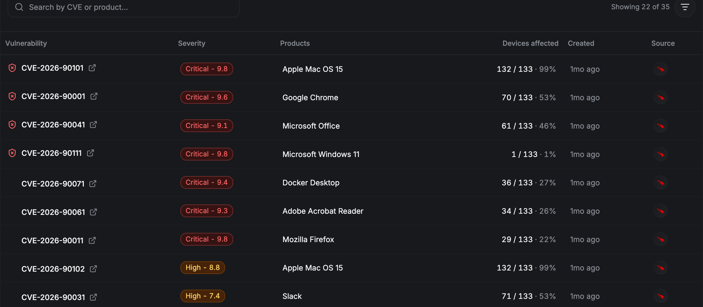
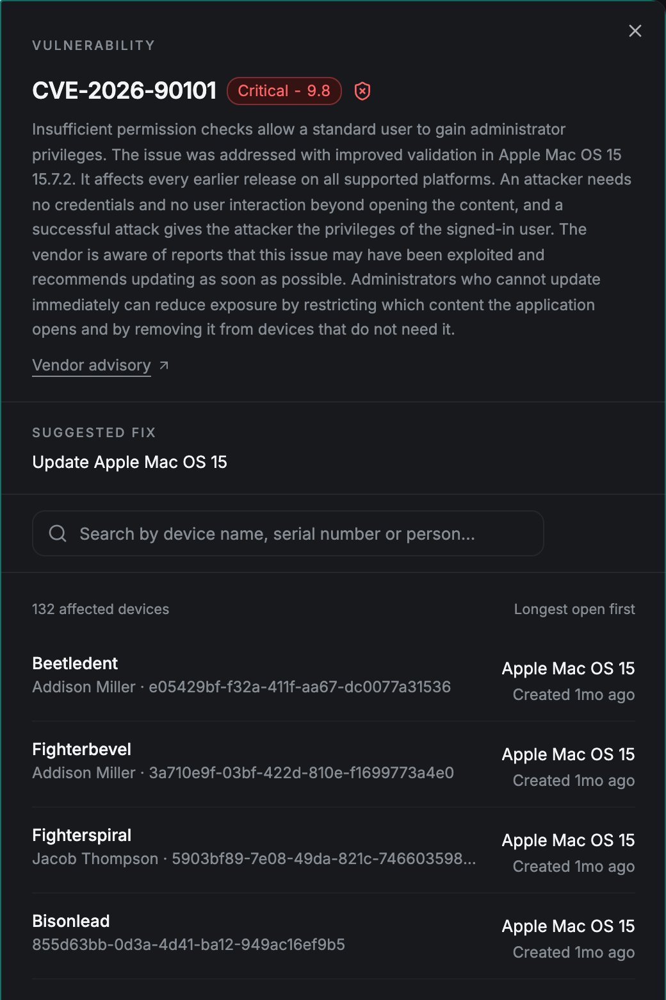
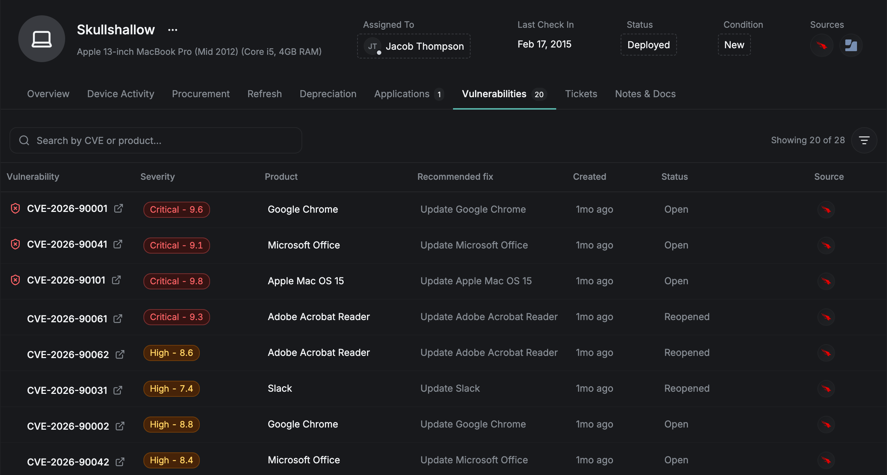

Vulnerabilities shows what your connected security tool reports: which vulnerabilities are open, and on which devices. Today that is [CrowdStrike Falcon](/integrations/crowdstrike). June shows vulnerabilities and does not change anything in the security tool. Fixing happens on the device or in your patching tool.

People whose role includes the **Device Compliance & management details** permission can see it. Admins and Owners have it.

<Frame caption="Assets > Vulnerabilities: search, the Display button, and one row per open vulnerability.">
  
</Frame>

## Work the list

Go to **Assets > Vulnerabilities**. The list shows open vulnerabilities only. Suppressed ones are left out. It opens on Critical and High.

Each row shows:

- The CVE id, its severity and score
- A marker when it is known to be exploited in the wild
- The products it is in: the first two, with a count for the rest
- How many devices it affects, out of the devices the security tool monitors, with the percentage
- When it was first found
- Which tool reported it

The default order is the order to work in: known exploited first, then the worst severity, then the most devices affected. Click a column header to sort instead. Search by CVE id or product name.

## Filter the list

The **Display** button holds the filters:

| Filter | Shows |
|---|---|
| Severity | The severities you pick |
| Exploit | Known exploited vulnerabilities only |
| Created | First found in the last 7, 30 or 90 days, or a custom range |
| Device group | Devices in the group you pick |
| Department | Devices assigned to people in that department |

The page shows "Showing X of Y" so you can see how much a filter hides. **Reset to Defaults** returns to Critical and High. Filters are remembered per organization.

The Department filter shows only to people who can see departments and people.

## See what to do about one

Click a row to open its panel.

<Frame caption="The panel for one vulnerability: description, advisory, suggested fix and affected devices.">
  
</Frame>

The panel has the description, a link to the vendor advisory, the suggested fix and the devices the vulnerability is open on.

**Suggested fix** is what the security tool recommends. There is usually one. When a vulnerability is open in several products there are several. The first three show, with the fix that covers the most devices first. **Show more** lists the rest.

**Affected devices** are listed longest open first. Each shows the device name, who it is assigned to, its serial number, the product (with a count when there are several) and when it was found. Search by device name, serial number or person. Click a device to open its Vulnerabilities tab.

When no device has the vulnerability open, the panel says so. Closed and suppressed records are not counted there.

## See one device

Devices a security tool reports have a **Vulnerabilities** tab. Its badge is the number of open vulnerabilities on that device.

<Frame caption="A device's Vulnerabilities tab, with the status and the fix for each one.">
  
</Frame>

The tab opens on **Open** for every device. The **Status** filter also offers All, Reopened, Suppressed, Closed, Expired and Not detected. Filters are not remembered between devices. The sort is.

| Status | Meaning |
|---|---|
| Open, Reopened, Closed, Expired | The security tool's own statuses |
| Suppressed | Your security team suppressed it in the security tool |
| Not detected | The tool stopped listing it without marking it closed. This takes two syncs in a row |

## How fresh it is

Data refreshes once a day, or when you run a sync from the integration's page. A vulnerability the security tool closes shows as Closed after the next sync.

## Ask June

June's agent can answer questions about this data, such as which devices have a given CVE, or how many open critical vulnerabilities each department has.

## FAQ

<AccordionGroup>
<Accordion title="Why does a device have no Vulnerabilities tab?">
No security tool reports that device. The tab appears once one does.
</Accordion>
<Accordion title="Why is the count lower than in my security tool?">
The list opens on Critical and High, and leaves out suppressed vulnerabilities. Open **Display** and widen Severity to see more.
</Accordion>
<Accordion title="I fixed a vulnerability and it still shows. Why?">
It clears after the security tool reports it closed and June syncs. Run a sync from the integration's page to pick it up sooner.
</Accordion>
</AccordionGroup>

## Related

- [CrowdStrike Falcon](/integrations/crowdstrike)
- [Assets](/assets/assets)
- [Asset sources](/assets/asset-sources)
- [Members and roles](/admin/roles)
