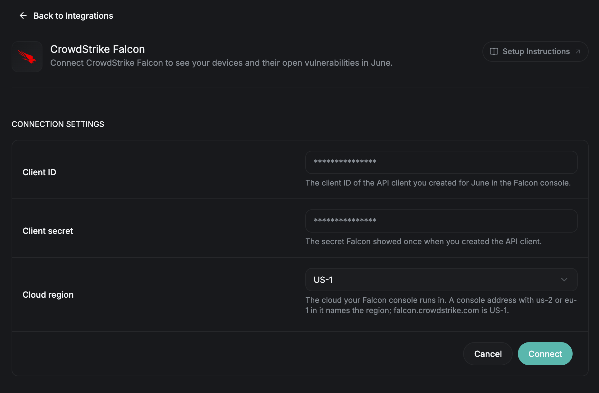

<Frame>
  
</Frame>

Connect CrowdStrike Falcon with June to see the devices Falcon monitors in your device inventory, and the open vulnerabilities on each of them. The integration is read-only: June reads from Falcon and never changes anything in it.

## What you'll accomplish
- Create a read-only API client in Falcon
- Connect Falcon to June
- See open vulnerabilities across your organization and on each device

## Prerequisites

Before starting the integration, ensure you have:
- Access to the Falcon console with permission to create API clients
- Falcon's vulnerability management (Spotlight) in your subscription, for vulnerabilities to appear
- The Admin or Owner role in June

## Permissions

June needs **Read** on two things in Falcon, and on a third if you want host groups. If a required one is missing, June names it when you connect.

| Permission | Required | What June does with it |
|------------|----------|------------------------|
| **Hosts** (Read) | Yes | Reads the devices Falcon monitors: name, serial number, model, operating system, sensor version, last signed-in user, tags, and when each was last seen. |
| **Vulnerabilities** (Read) | Yes | Reads the vulnerabilities Falcon finds on those devices, with the product, severity, suggested fix and status. |
| **Host groups** (Read) | Optional | Reads your Falcon host groups, so they show on devices in June and can filter the vulnerability list. Without it, everything else still syncs. |

<Note>
The API client needs no **Write** permission.
</Note>

## Setup Process

### Step 1: Create an API client in Falcon

<Steps>
  <Step title="Open API clients and keys">
    1. Log into the Falcon console
    2. Go to **Support and resources** > **API clients and keys**
    3. Create an API client. A suggested name is "June".
  </Step>

  <Step title="Choose permissions">
    Tick **Read** for **Hosts** and **Vulnerabilities**. Tick **Read** for **Host groups** too if you want host groups in June. [Permissions](#permissions) says what each one is for.
  </Step>

  <Step title="Copy the Client ID and secret">
    Falcon shows the **Client ID** and the **secret**. The secret is shown only once, so copy both.
  </Step>
</Steps>

### Step 2: Connect Falcon in June

<Steps>
  <Step title="Select CrowdStrike Falcon">
    1. Log into June
    2. Go to **Settings** > **Integrations**
    3. Choose **CrowdStrike Falcon**
  </Step>

  <Step title="Enter your details">
    Provide the following:
    - **Client ID**: from Step 1
    - **Client secret**: from Step 1
    - **Cloud region**: **US-1**, **US-2**, **EU-1** or **US-GOV-1**

    Your Falcon console's address tells you the region. An address with `us-2` or `eu-1` in it names the region. `falcon.crowdstrike.com` is US-1.

    Then click **Connect**.
  </Step>

  <Step title="Test connection">
    June tests the connection when you connect. If something is wrong, it tells you plainly: the credentials were refused, the region is wrong (and which region is right), or the **Hosts** or **Vulnerabilities** read permission is missing.
  </Step>
</Steps>

### Step 3: Your first sync

The first sync starts when you connect. A first sync of a large account takes several minutes. After that, June syncs once a day. To sync at any time, open the **Connected** menu on the integration's page and select **Sync Now**.

## What June reads from Falcon

| Data | What June reads |
|------|-----------------|
| **Hosts** | Hostname, serial number, manufacturer and model, platform and OS version, sensor version, when the host was first and last seen, the last signed-in user, tags, and host group membership |
| **Host groups** | Name and description |
| **Vulnerabilities** | At every severity: the CVE and its details, severity and score, exploit status, the product and version, the suggested fix, the status, and whether it is suppressed |

### How devices are matched

- June matches a Falcon host to a device already in your inventory by serial number, and does not change that device's existing details.
- A host that no other source has reported is added as a new device.
- A host with no serial number is not added, and its vulnerabilities are not shown.

## Vulnerabilities in June

After the first sync, the devices Falcon monitors are in your inventory, **Assets** > **Vulnerabilities** lists your open vulnerabilities, and each device has a **Vulnerabilities** tab. With the optional **Host groups** permission, Falcon host groups show as device groups. [Vulnerabilities](/assets/vulnerabilities) explains how to use them.

## Disconnecting

When you disconnect, syncing stops and vulnerabilities that were open are closed in June. Devices stay in your inventory. Disconnect is unavailable while a sync is running.

## Troubleshooting

<AccordionGroup>
  <Accordion title="Credentials refused">
    **Possible causes**: The Client ID or secret is wrong, or the API client was deleted or reset in Falcon.

    **Solutions**:
    - Create a new secret in Falcon and connect again
  </Accordion>

  <Accordion title="Wrong region">
    **Symptoms**: June says the region is wrong and names the region your credentials belong to.

    **Solutions**:
    - Pick the region June names and connect again
  </Accordion>

  <Accordion title="Missing permission">
    **Symptoms**: June names the **Hosts** or **Vulnerabilities** read permission as missing.

    **Solutions**:
    - In Falcon, go to **Support and resources** > **API clients and keys** and edit the API client
    - Tick **Read** for the permission June named
    - Test the connection again
  </Accordion>

  <Accordion title="No device groups">
    **Possible cause**: The API client does not have **Read** for **Host groups**.

    **Solutions**:
    - Edit the API client in Falcon and tick **Read** for **Host groups**
  </Accordion>

  <Accordion title="A device is missing">
    **Possible cause**: The host has no serial number in Falcon.
  </Accordion>

  <Accordion title="No vulnerabilities">
    **Solutions**:
    - Check that Falcon's vulnerability management is part of your subscription
    - Check that the Falcon console lists vulnerabilities
  </Accordion>
</AccordionGroup>

## Next Steps

<CardGroup cols={2}>
  <Card title="Assets" href="/assets/assets">
    Find, filter and assign the devices Falcon syncs
  </Card>

  <Card title="Vulnerabilities" href="/assets/vulnerabilities">
    See which vulnerabilities are open and which devices they affect
  </Card>
</CardGroup>

## Support Resources

Need help with your CrowdStrike Falcon integration?

- **CrowdStrike Documentation**: Review CrowdStrike's guides for API clients
- **Integration Support**: Contact June support for integration-specific issues
