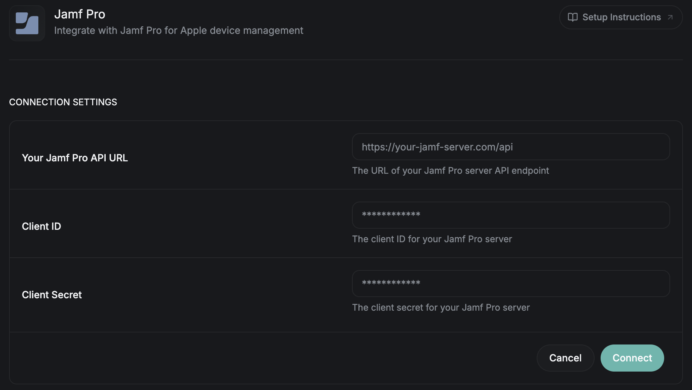

<Frame>
  
</Frame>
Connect your Jamf Pro environment with June for comprehensive Mac device management and asset tracking.

## What you'll accomplish
- Set up API access in Jamf Pro
- Configure the June integration
- Get device changes into June within minutes using webhooks
- Understand data synchronization
- Troubleshoot common issues

## Prerequisites

Before starting the integration, ensure you have:
- Jamf Pro administrator access
- API access enabled in Jamf Pro
- Network connectivity between June and Jamf Pro server
- The Admin or Owner role in June

## Setup Process

### Step 1: Create API Account in Jamf Pro

<Steps>
  <Step title="Setting up API role">
    1. Log into your Jamf Pro server
    2. Navigate to Settings > System > API roles and clients
    3. Go to the API roles tab and click the "+" button to create a new API role
    4. Set the API role name to "June Integration"
    5. Assign these privileges:
      - To sync devices, people and groups:
        - `Read Computers`, `Read Mobile Devices`, `Read Users`, `Read Departments`, `Read Buildings`
        - `Read Mac Applications`, `Read Mobile Device Applications`
        - `Read Smart Computer Groups`, `Read Static Computer Groups`, `Read Smart Mobile Device Groups`, `Read Static Mobile Device Groups`
        - `Read Computer Extension Attributes`, `Read Mobile Device Extension Attributes`
        - `Read Computer PreStage Enrollments` (optional): shows Macs assigned to a PreStage enrollment that haven't enrolled yet
      - To send assignee and location changes made in June back to Jamf Pro: `Update Computers`, `Update Mobile Devices`, `Assign Users to Mobile Devices`, `Update Users`
      - To look up device secrets when an admin asks: `View Computer Device Lock Pin`, `View Recovery Lock`, `View Disk Encryption Recovery Key`
      - For device actions:
        - `Delete Computers`, `Delete Mobile Devices`
        - `View MDM command information in Jamf Pro API`, `Send Declarative Management Command`
        - `Send Computer Remote Lock Command`, `Send Mobile Device Remote Lock Command`, `Send Computer Remote Desktop Command`
        - `Send Mobile Device Restart Device Command`, `Send Mobile Device Shut Down Command`, `Send Computer Restart Command`, `Send Computer Shut Down Command`
    6. Click "Save"
  </Step>
  
  <Step title="Setting up API client">
    1. Go to the API clients tab and click the "+" button to create a new API client
    2. Set the API client name to "June Integration API Client"
    3. Select the API role you created in the previous step
    4. Leave **Access token lifetime** at its default
    5. Click on the "Enable API client" button
    6. Click "Save"
    7. Generate the API client secret by clicking on the "Generate" button
    8. Note the client ID and client secret for June configuration which we will use in the next step.
  </Step>
</Steps>

### Step 2: Connect Jamf Pro in June

<Steps>
  <Step title="Open the Jamf Pro integration">
    1. Log into June
    2. Go to **Settings** > **Integrations**
    3. Select **Jamf Pro** under **Available Integrations**
  </Step>
  
  <Step title="Configure Jamf Pro">
    1. Provide the following information:
    - **Your Jamf Pro API URL**: Your Jamf Pro server URL (e.g., `https://yourcompany.jamfcloud.com`).
    - **Client ID**: Client ID from the API client created in Step 1
    - **Client Secret**: Client Secret from the API client created in Step 1
    2. Click **Connect**
    3. June tests the connection. If it succeeds, the integration shows **Connected** and the first sync starts automatically.
  </Step>
  
  <Step title="Test Connection">
    1. To check the connection later, open the **Connected** menu at the top of the integration's page and select **Test Connection**.
    2. June signs in to Jamf Pro with your API client and shows whether it succeeded
    3. Resolve any connection issues before proceeding
  </Step>

  <Step title="Follow the sync">
    1. The first sync starts when you connect. To sync again at any time, select **Sync Now** from the **Connected** menu.
    2. You can follow progress in **Sync Status** and **Last Sync** on the integration's page.
    3. Assets appear in June as the sync runs.
  </Step>
  
</Steps>

### Step 3: Review Capabilities

<Steps>
  <Step title="Sync Schedule">
    June syncs with Jamf Pro once a day. With [webhooks](#webhooks) set up, a device's changes reach June within minutes, and the daily sync still runs. Use **Sync Now** whenever you need fresher data.
  </Step>
  
  <Step title="What June Syncs">
    The **Capabilities** section on the integration's page lists what June syncs from Jamf Pro:
    - Sync all devices (always on)
    - Sync all employees
    - Sync locations (Jamf Pro buildings)
    - Sync Software Applications (installed apps)
    - Sync purchase data
    
    It also lists the device actions June can take in Jamf Pro: delete a device, restart, shut down, lock, turn Remote Desktop on or off, force a check-in, and look up a device lock PIN, recovery lock password or FileVault recovery key. Device actions need the device action privileges from Step 1. June also sends assignee and location changes made in June back to Jamf Pro.
  </Step>
</Steps>

## Webhooks

Webhooks are optional. Without them, June updates devices from Jamf Pro once a day. With webhooks, Jamf Pro tells June when a device changes, and June updates that device within a few minutes. The daily sync keeps running either way.

Webhooks need no extra privileges for the API role you created in Step 1.

Three Jamf Pro events are covered. You add each one in Jamf Pro as its own webhook:

| Event | When it fires | What June does |
|-------|---------------|----------------|
| `ComputerInventoryCompleted` | A Mac sent Jamf Pro an inventory update. Jamf Pro does this on the inventory schedule, by default daily, and whenever inventory is updated. | Updates that Mac |
| `MobileDeviceInventoryCompleted` | An iPhone or iPad sent an inventory update. | Updates that device |
| `MobileDeviceUnEnrolled` | An iPhone or iPad was removed from management. | Shows the device is no longer managed by Jamf Pro |

A new device appears in June after its first inventory update, not at the moment it enrolls. Two changes still wait for the daily sync: a Mac removed from management, and any device deleted from Jamf Pro.

### Step 1: Register the webhook in June

You need the Admin or Owner role in June.

<Steps>
  <Step title="Register">
    1. In June, go to **Settings** > **Integrations** and select **Jamf Pro** under **Configured Integrations**
    2. In the **Webhooks** section, which says **No webhook configured**, click **Register**
    3. June creates the webhook URL and secret and opens **Status**
  </Step>

  <Step title="Copy the URL and header">
    Once registered, the **Webhooks** section shows **Webhook connected** with **Status**, **Pause** and **Unregister**. Below it:
    - **Webhook URL**: use the copy button
    - **Webhook Secret**: shows a **Set** badge, with a show button, a copy button and **Replace**. The copy button copies the header in the form Jamf Pro asks for, for example `{"X-June-Webhook-Secret":"<your-webhook-secret>"}`.

    Other roles see the URL and **Status**, but not the secret or the buttons.
  </Step>
</Steps>

### Step 2: Create the webhooks in Jamf Pro

Repeat these steps once per event, so you end up with three webhooks.

<Steps>
  <Step title="Create the webhook">
    1. In Jamf Pro, go to **Settings** > **Global** > **Webhooks** and click **New**
    2. **Display Name**: anything you like, for example "June: ComputerInventoryCompleted". Keep **Enabled** checked.
    3. **Webhook URL**: paste the URL from June
    4. **Authentication type**: choose **Header Authentication** and paste the header you copied from June
    5. **Content Type**: choose **JSON**
    6. **Webhook Event**: choose one of the three events
    7. Save. Leave the timeouts at their defaults.
  </Step>

  <Step title="Check it works">
    After the next inventory update, open **Status** in June's **Webhooks** section. It opens a window titled **Jamf webhooks** that lists the three events. An event that has arrived shows when June last received it, instead of **Not received yet**.
  </Step>
</Steps>

### Manage the webhook

- **Pause**: June ignores what Jamf Pro sends until you click **Resume**. The URL and secret stay the same, so nothing changes in Jamf Pro. Devices still update in the daily sync.
- **Replace** (next to the secret): asks you to confirm. The old secret stops working at once. Paste the new header into all three webhooks in Jamf Pro, or June stops getting changes.
- **Unregister**: asks you to confirm. The URL and secret stop working, so delete the three webhooks in Jamf Pro. Registering again gives a new URL and secret to enter in every webhook.

## Data Synchronization

### What Gets Synced

|Data Type | Jamf Pro Source | June Destination | Notes |
|-----------|----------------|------------------|--------|
| **Device Identity** | Computer Name, Serial Number, Asset Tag | Device Name, Serial Number, Asset Tag | Primary device identification |
| **Hardware Info** | Model, Processor, Memory, Storage | Hardware Specifications | Complete hardware inventory |
| **Software** | Operating System, Software Applications | System Info, App Inventory | OS version and installed apps |
| **User Assignment** | User and Location fields | Employee Assignment | Links devices to users |
| **Compliance** | Last check-in, security settings (FileVault, firewall, SIP, Gatekeeper, Secure Boot, Activation Lock) | Compliance and security details | Device connectivity and compliance |
| **Smart Groups** | Smart Groups and their criteria | Device Groups | Which groups each device belongs to |
| **Extension Attributes** | Extension attribute definitions and values | Device Attributes | Your custom device fields and what they mean |
| **Department Data** | Device assignment to departments | Department and Location | Organizational groupings |
| **Purchase Data** | PO Date, PO Number, Purchase Price, Vendor, Warranty Date, Lease dates, Life Expectancy | Purchase Details | Purchase data for assets |

### Sync Process

1. **Initial Sync**: Complete inventory sync on first connection
2. **Daily Updates**: June pulls the latest data from Jamf Pro once a day, and with [webhooks](#webhooks) set up, a device's changes reach June within minutes. App usage data syncs once a week.
3. **Conflict Resolution**: When your identity provider and Jamf Pro disagree about a person's details, the identity provider wins. See [Asset status](/assets/asset-status) for how Jamf Pro sets a device's status and assignee.
4. **Removed Devices**: Each night, June checks for devices that are no longer in Jamf Pro and stops counting them as managed by Jamf Pro.
5. **Failed Syncs**: The integration's page shows **Sync failed**, and the **Activity** section shows the error.

## Troubleshooting

### Common Connection Issues

<AccordionGroup>
  <Accordion title="Authentication Failures">
    **Symptoms**: "Failed to connect to Jamf Pro" when you connect or test the connection
    
    **Solutions**:
    - Verify the Client ID and Client Secret
    - Ensure the API client is enabled in Jamf Pro
    - Check whether the client secret was regenerated or has expired
    - Confirm the API client is assigned the June API role
    - Select **Test Connection** from the **Connected** menu to verify the connection.
  </Accordion>
  
  <Accordion title="Network Connectivity">
    **Symptoms**: Connection timeouts or "Unable to reach server" errors
    
    **Solutions**:
    - Verify the Jamf Pro server URL is correct and reachable from the internet
    - Ensure SSL certificate is valid (for HTTPS connections)
    - Select **Test Connection** from the **Connected** menu to verify the connection.
  </Accordion>
  
  <Accordion title="Permission Errors">
    **Symptoms**: "Access denied" or "Insufficient privileges" errors
    
    **Solutions**:
    - Review API account permissions in Jamf Pro
    - Ensure all required object permissions are granted
    - Check if permissions apply to the right scope (All Objects vs. specific categories)
    - Verify the API client is enabled
    - Select **Test Connection** from the **Connected** menu to verify the connection.
  </Accordion>
</AccordionGroup>

### Sync Issues

<AccordionGroup>
  <Accordion title="Missing Devices">
    **Possible Causes**:
    - Devices not enrolled in Jamf Pro
    - Devices haven't checked in recently
    - Insufficient permissions to access certain devices
    
    **Solutions**:
    - Verify device enrollment status in Jamf Pro
    - Check last inventory date for missing devices
    - Confirm API permissions cover all required devices
  </Accordion>
  
  <Accordion title="Outdated Information">
    **Possible Causes**:
    - Devices not checking in regularly
    - The last sync ran before the change
    - Network issues preventing updates
    
    **Solutions**:
    - Select **Sync Now** from the **Connected** menu on the integration's page to pull the latest data from Jamf Pro. Jamf Pro only has new inventory after a device checks in.
    - Check device connectivity and management status
    - Check the **Activity** section on the integration's page for specific error messages
  </Accordion>

  <Accordion title="Webhook Events Not Arriving">
    **Symptoms**: An event in **Status** still shows **Not received yet** after devices have updated in Jamf Pro

    **Possible Causes**:
    - The webhook for that event is missing or disabled in Jamf Pro
    - The URL was pasted incompletely
    - The header is wrong, or it is from before the secret was replaced
    - The webhook is **Paused** in June

    **Solutions**:
    - In Jamf Pro, check that a webhook exists for that event and that **Enabled** is checked
    - Copy the **Webhook URL** from June again and paste it in full
    - Copy the header from June again and update the webhook
    - If June shows **Paused**, click **Resume**
  </Accordion>
  
  <Accordion title="Performance Problems">
    **Symptoms**: Slow syncs or timeouts
    
    **Solutions**:
    - Large environments take longer to sync. Follow progress in **Sync Status** on the integration's page.
    - Monitor Jamf Pro server performance during sync windows
    - If a sync fails, check the **Activity** section for the error and contact June support
  </Accordion>
</AccordionGroup>

## Next Steps

Once your Jamf Pro integration is configured:

<CardGroup cols={2}>
  <Card title="Assets" href="/assets/assets">
    Find, filter and assign the devices Jamf Pro syncs
  </Card>

  <Card title="Asset status" href="/assets/asset-status">
    How Jamf Pro sets each device's status and assignee
  </Card>

  <Card title="Compliance" href="/assets/compliance">
    See which devices meet your security requirements
  </Card>

  <Card title="Employees" href="/people/employees">
    Connect your identity provider so devices match the right people
  </Card>
</CardGroup>

## Support

Need help with your Jamf Pro integration?

- **Documentation**: Review Jamf Pro API documentation
- **Support**: Contact June support with integration issues

<Note>
The first sync starts as soon as you connect Jamf Pro. Large environments take longer for the initial sync to complete.
</Note> 
