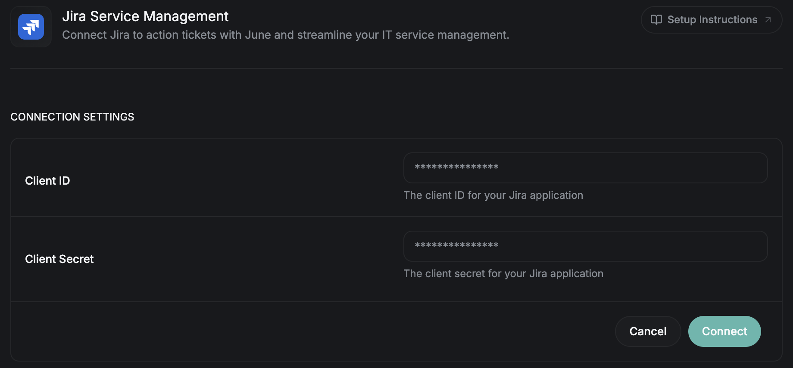
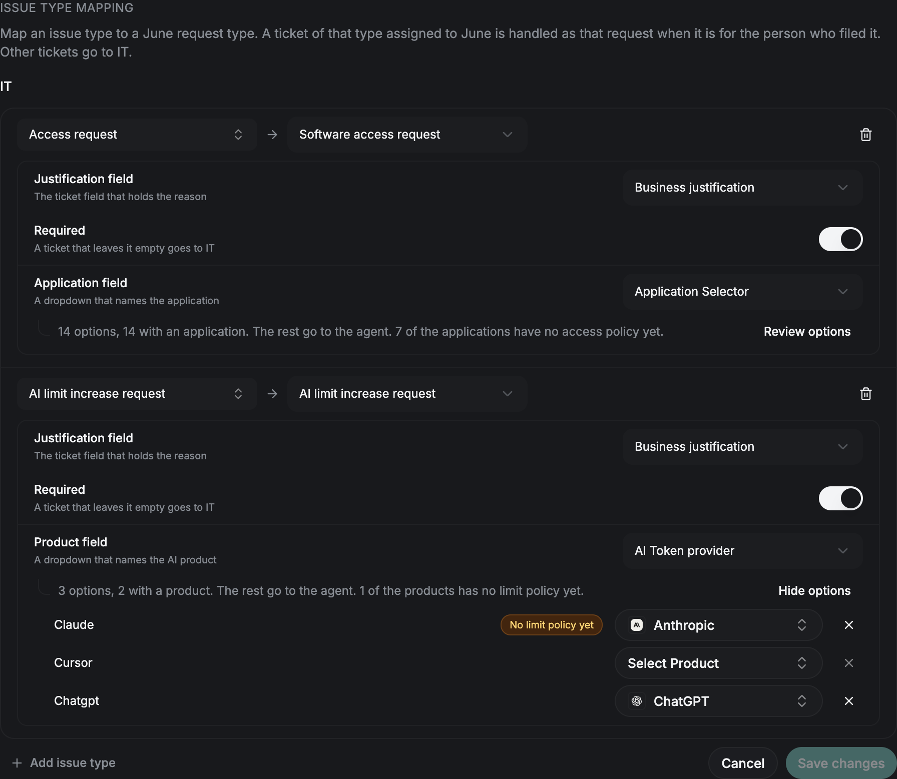

<Frame>
  
</Frame>
Connect your Jira environment with June to enable an intelligent AI agent that can triage, respond to, and manage tickets on your behalf.

<Info>
June does **not** import your Jira backlog. June works on tickets you assign to it or mention it in. In the projects you track, June also records new tickets so it can link them to the people and devices they are about. See [Ticket context](/agents/ticket-context#linking-tickets-to-people-and-devices).
</Info>

## What you'll accomplish

- Create a service account in Atlassian Admin
- Generate OAuth 2.0 credentials for secure API access
- Configure the June integration
- Set up webhooks so June can respond to ticket events
- Learn how to trigger June to act on tickets

## Prerequisites

Before starting the integration, ensure you have:

- Atlassian organization admin access
- Access to create service accounts in Atlassian Admin
- The Admin or Owner role in June
- Understanding of which Jira projects you want to integrate

## How June Works with Jira

### Triggering June

There are two ways to have June act on a Jira ticket:

<CardGroup cols={2}>
  <Card title="Mention June in a Comment" icon="at">
    Tag the June service account in a comment (e.g., `@June AI please triage this ticket`). June will read the ticket and respond.
  </Card>
  
  <Card title="Assign a Ticket to June" icon="user-check">
    Assign any ticket to the June service account. June starts a request for it, comments on the ticket with a link to the request, and works on it.
  </Card>
</CardGroup>

### Closing and Reopening Tickets

When a ticket June is tracking is closed in Jira, June closes its request too. A ticket moved to a canceled status cancels the request, and a ticket moved to any other done status marks it Done. Reopening the ticket reopens the request and gives it to IT. See [Jira sync](/help-desk/requests#jira-sync) for the full rules.

<Note>
  June recognizes a closed ticket by Jira's **Done** status category, not by the status name. Before you go live, open each workflow June works with and check that every closed and canceled status is in the Done category.
</Note>

### Comments and Edits

Comments on a ticket reach its request in June, and edits to the ticket's title and description update the request. See [Comments and edits on the ticket](/help-desk/requests#comments-and-edits-on-the-ticket). To have June handle every ticket of an issue type as a specific request, see [Issue type mapping](#issue-type-mapping).

### Available Actions

Once triggered, June can perform the following actions on Jira tickets:

| Action | Description |
|--------|-------------|
| **Create ticket** | Create a new issue in any project with summary, description, issue type, priority, and assignee |
| **Get ticket** | Read ticket details including summary, description, status, priority, assignee, and comments |
| **Update description** | Modify the description/body of an existing ticket |
| **Add comment** | Post comments on tickets (supports internal/private comments for JSM) |
| **Transition ticket** | Change ticket status (e.g., Open → In Progress → Resolved) |
| **Assign to June** | Take ownership of a ticket |
| **Unassign ticket** | Remove the current assignee from a ticket |

### Example Use Cases

<AccordionGroup>
  <Accordion title="Resolve incoming requests">
    Assign tickets to June. June works on the request, replies to the reporter in public comments, and hands it to IT when it can't resolve it.
  </Accordion>
  
  <Accordion title="Answer common questions">
    Mention June in a comment to get AI-assisted responses based on your knowledge base and asset data.
  </Accordion>
  
  <Accordion title="Add context to new tickets">
    In the projects you track, June adds an internal comment to new tickets with the details IT needs about the people and devices involved. See [Ticket context](/agents/ticket-context).
  </Accordion>
  
  <Accordion title="Run a runbook on new tickets">
    Start a [runbook](/agents/runbooks) when a ticket is created in a project and matches the conditions you choose.
  </Accordion>
</AccordionGroup>

## Setup Process

### Step 1: Create a Service Account

<Steps>
  <Step title="Access Atlassian Admin">
    1. Go to [Atlassian Admin](https://admin.atlassian.com)
    2. Log in with your organization admin credentials
    3. Navigate to **Directory** → **Service accounts**
  </Step>
  
  <Step title="Create Service Account">
    1. Click **Create service account**
    2. Enter a name: `June AI` and an optional description.
    3. Select the app roles you want to grant to the service account.
        - **Jira Service Management**: Grant the `User(agent)` role to the service account.
        - **Jira Software**: Grant the `User` role to the service account.
    4. Click **Save** to create the service account
  </Step>
</Steps>
### Step 2: Create OAuth 2.0 Credentials

<Steps>
  <Step title="Access Service Account Settings">
    1. Select the service account you just created (`june-integration`)
    2. Click **Create credentials**
    3. Select **OAuth 2.0**, then click **Next**
    4. Set a name for the credentials: `june-service-account-credentials`.
  </Step>
  
  <Step title="Configure Required Scopes">
    Select the following scopes based on your integration needs:
    
    **Required scopes (all integrations):**
    - `read:jira-work` - Read issues and projects data
    - `write:jira-work` - Create/edit/delete issues, post comments as user, create worklogs.
    - `read:jira-user` - View user information (email, username, avatar)
  </Step>
  
  <Step title="Generate Credentials">
    1. Click **Create** to generate the credentials
    2. **Immediately copy** the `client_id` and `client_secret`
    3. Store these credentials securely. We will need these credentials in the next step to configure the June integration.
    
    <Warning>
    You won't be able to view the`client_id` and `client_secret` again after leaving this page. If you lose it, you'll need to create new credentials.
    </Warning>
  </Step>
</Steps>

### Step 3: Add Service Account to Projects

The service account needs access to each Jira project you want to integrate with June.

<Steps>
  <Step title="Navigate to Project Settings">
    1. Go to your Jira instance
    2. Open the project you want to integrate
    3. Navigate to **Project settings** → **People** (or **Access** depending on your Jira version)
  </Step>
  
  <Step title="Add Service Account">
    1. Click **Add people**
    2. Search for the service account email or username from the previous step.
    3. Assign an appropriate role:
       - **Service Desk Team** for Jira Service Management projects
       - **Member** for Jira Software projects
    4. Click **Add** to confirm
  </Step>
  
  <Step title="Let June Set the Reporter">
    When June hands a Slack request to IT, it creates a tracking ticket and sets the employee as its reporter. Jira allows this only if the service account has the **Modify Reporter** permission in the project.

    - **Company-managed project**: grant **Modify Reporter** to the service account's role in the project's permission scheme.
    - **Team-managed project**: give the service account a role that includes it, such as **Administrator**.

    Without this permission, June still creates the ticket. It shows the service account as the reporter and names the employee in the description.
  </Step>

  <Step title="Repeat for Additional Projects">
    Repeat the above steps for each project you want to integrate with June.
  </Step>
</Steps>

### Step 4: Configure June Integration

<Steps>
  <Step title="Access June Integrations">
    1. Log into June
    2. Go to **Settings** > **Integrations**
    3. Select **Jira Service Management** under **Available Integrations** (in the **Service Management** group)
  </Step>
  
  <Step title="Enter Credentials">
    Provide the following information:
    - **Client ID**: The `client_id` from Step 2
    - **Client Secret**: The `client_secret` from Step 2
  </Step>
  
  <Step title="Connect and Select Instance">
    1. Click **Connect**
    2. Verify the integration shows **Connected**
    3. Once connected, choose **Edit** under **Connection Settings** to set the **Default Project Key**, the project where June creates new tickets. June also tracks new tickets in this project. You can enter several project keys separated by commas. This is optional and can be changed later.
  </Step>
  
  <Step title="Test the Connection">
    1. Open the **Connected** menu at the top of the integration's page and select **Test Connection**
    2. June signs in with the service account credentials and shows whether it succeeded
    3. Resolve any authentication issues before proceeding
  </Step>

  <Step title="Test ticket creation">
    1. Open the **Connected** menu and select **Create Test Ticket**.
    2. A ticket will be created in the default project you specified above.
    3. Once the ticket is created, you can validate the ticket was created by the service account user.
    4. Feel free to close or delete the ticket after testing.
  </Step>
</Steps>

## Webhook Configuration

Webhooks notify June when tickets are created, updated, or commented on, so June can respond in real time when triggered by mentions or assignments.

### Step 1: Get Your Webhook URL

<Steps>
  <Step title="Access Webhook Settings">
    1. In June, go to **Settings** > **Integrations** and select **Jira Service Management** under **Configured Integrations**
    2. Under the **Webhooks** section, click **Register**
    3. Copy the generated **Webhook URL**
  </Step>
</Steps>

### Step 2: Create Webhook in Jira

<Steps>
  <Step title="Access Jira System Settings">
    1. Go to your Jira instance
    2. Click the **Settings** gear icon at the top right corner of the page.
    3. Navigate to **System** > **Webhooks**
  </Step>
  
  <Step title="Create New Webhook">
    1. Click **Create a webhook**
    2. Configure the following settings:
       - **Name**: `June Integration`
       - **URL**: Paste the webhook URL from Step 1
       - **Secret**: Generate a secure secret and save it for the next step.

  </Step>
  
  <Step title="Select Webhook Events">
    Choose which events should trigger the webhook:
    - `Issue created` - When new issues are created
    - `Issue updated` - When issues are modified
    - `Issue deleted` - When issues are deleted
    - `Comment created` - When comments are added
    - `Comment updated` - When comments are edited
    - `Comment deleted` - When comments are deleted
    
    <Tip>
    Use the **JQL Filter** field to limit which issues trigger webhooks. For example, `project = SUP` will only send webhooks for issues in the SUP project.
    </Tip>
  </Step>
  
  <Step title="Save Webhook">
    Click **Create** to save the webhook configuration.
  </Step>
</Steps>

### Step 3: Save Webhook Secret in June

<Steps>
  <Step title="Complete Webhook Setup">
    1. Return to the **Webhooks** section of June's Jira integration
    2. Enter the webhook secret you generated in Jira
    3. Click **Save**
    4. The section shows **Webhook connected**, and June receives real-time updates
    
    <Check>
    Test by creating a ticket in Jira and mentioning the June service account in a comment. June should respond within a few moments.
    </Check>
  </Step>
</Steps>

## Issue type mapping

Tell June that every ticket of a Jira issue type is a specific kind of request. June then handles those tickets as that request, without working out what each ticket is about.

Managing integrations requires an admin. Go to **Settings** > **Integrations**, select **Jira Service Management** under **Configured Integrations**, and open **Issue type mapping**. The section lists each connected Jira project. Click **Edit**, make your changes, and click **Save changes**.

<Frame caption="Issue type mapping in Edit mode: two issue types, their fields, and the options of a product dropdown">
  
</Frame>

### What a mapping does

A mapping pairs one Jira issue type with one June request type:

| Request type | Use it for |
|---|---|
| **Software access request** | Tickets where an employee asks for access to an application. See [Access requests](/help-desk/access-requests). |
| **AI limit increase request** | Tickets where an employee asks for a higher AI limit. Available when [AI limit requests](/help-desk/ai-limit-requests) are turned on for your organization. |

When a ticket of a mapped issue type is assigned to June, June handles it as that request for one person, chosen by the **Requester field** (see [Fields you can set](#fields-you-can-set)). A ticket whose reporter isn't an active employee goes to IT when the requester field is **Reporter**.

Issue types with no mapping work as before: June reads the ticket and decides how to handle it.

<Note>
  A mapping applies when a ticket is assigned to June. It does not apply when June is only mentioned on a ticket.
</Note>

### Fields you can set

| Field | What it does |
|---|---|
| **Requester field** | Who the request is for. The default is **Reporter**, Jira's reporter. You can instead pick a user field or a People field on that issue type's form. A ticket that leaves it empty goes to IT. |
| **Justification field** (optional) | The ticket field that holds the reason for the request. Only text fields on that issue type's own form are offered. |
| **Required** | Turn it on and a ticket that leaves the justification field empty goes to IT. Turn it off and June uses the ticket's own text as the reason when the field is empty. |
| **Application field** (optional) | A dropdown on the ticket that names the application. On an AI limit mapping it is called **Product field** and names the AI product. |
| **Default application** | Every ticket of this issue type is for this one application. Choose it when you have no application field. On an AI limit mapping it is called **Default product**. |

When the requester field names one active employee, the request is for that person. When you use a field other than **Reporter**, June sends the ticket to IT if the field:

- is empty,
- names more than one person,
- names someone who isn't an active employee in June, or
- is no longer on the ticket.

June still creates the request, in the reporter's name, and sets it to **Waiting for IT**. It files no access or limit request. It says why in a note on the request and in a comment on the Jira ticket, for example: "June couldn't tell who this request is for: … It's with IT as REQ-…".

Filling in or changing the requester field after June has taken the ticket doesn't change who the request is for.

Each option in the application dropdown is matched to an application in June. June suggests matches by name. A suggestion shows **Matched by name, not saved** until you click **Save changes**. Click **Review options** to see the list of options and change any match. For an option with no match, June works out the application from the ticket.

When the requester changes the justification or the application on the ticket later, June uses the new value and adds an internal note to the request saying what changed. This applies until an access request or AI limit request is filed.

Next to an application you may see one of these warnings:

| Warning | What it means |
|---|---|
| **No access policy yet** | The application has no access policy in June, so June cannot grant it. |
| **No limit policy yet** | The AI product has no limit policy in June. |
| **No limit requests for this product** | AI limit requests are not available for this AI product. |

### Example

Your service desk has a **Software Access Request** issue type. Its form has a **Business justification** paragraph field and an **Application** dropdown.

1. Under **Issue type mapping**, click **Edit** on the project.
2. Pair **Software Access Request** with **Software access request**.
3. Set **Justification field** to **Business justification** and turn on **Required**.
4. Set **Application field** to **Application**, then click **Review options** and check each match.
5. Click **Save changes**.

### What the employee sees

When the ticket already says everything June needs, June files the request straight away and replies on the ticket. That means one matched application with a single access level, and a justification if one is required.

When something is missing, June asks the employee on the ticket. For example, an application with several access levels needs the employee to pick one. Approvals work as they do for any [access request](/help-desk/access-requests) or [AI limit request](/help-desk/ai-limit-requests).

## API Scopes Reference

| Scope | Description | Required |
|-------|-------------|----------|
| `read:jira-work` | Read issues, projects, and boards | Yes |
| `write:jira-work` | Create and update issues | Yes |
| `read:jira-user` | Read user profiles | Yes |
| `read:servicedesk-request` | Read JSM requests | JSM only |
| `write:servicedesk-request` | Create JSM requests | JSM only |

## Troubleshooting

### Common Authentication Issues

<AccordionGroup>
  <Accordion title="No accessible Jira instances found">
    **Symptoms**: Error message stating no Jira instances are accessible
    
    **Solutions**:
    - Ensure the service account has been granted access to at least one Jira site
    - Verify the OAuth scopes include `read:jira-work`
    - Check that the service account is active and not disabled
    - Update the Client ID and Client Secret under **Connection Settings** in June, then select **Test Connection**
  </Accordion>
  
  <Accordion title="404 errors when fetching issues">
    **Symptoms**: Issues not appearing or 404 errors in the integration's **Activity** section
    
    **Solutions**:
    - The service account doesn't have access to the project
    - Add the service account to the project with at least "Browse Projects" permission
    - Verify the project key is correct in any JQL filters
    - Check if the project has been archived or deleted
  </Accordion>
  
  <Accordion title="Authentication errors">
    **Symptoms**: "Invalid credentials" or "Authentication failed" errors
    
    **Solutions**:
    - Client credentials may have been revoked in Atlassian Admin
    - Re-create OAuth 2.0 credentials and update in June
    - Verify the client ID and secret were copied correctly
    - Check if the service account has been disabled
  </Accordion>
</AccordionGroup>

### Webhook Issues

<AccordionGroup>
  <Accordion title="Webhook events not arriving">
    **Possible Causes**:
    - Webhook URL is incorrect in Jira
    - Webhook is paused or disabled
    - Webhook secret mismatch between Jira and June
    - JQL filter is excluding your issues
    
    **Solutions**:
    - Verify the webhook URL is correct in Jira settings
    - Ensure the webhook is enabled (not paused)
    - Confirm the webhook secret matches in both Jira and June
    - Test without JQL filters to verify basic functionality
    - Check Jira's webhook logs for delivery errors
  </Accordion>
  
  <Accordion title="Duplicate events received">
    **Possible Causes**:
    - Multiple webhooks configured for the same events
    - Webhook retry mechanism triggering duplicates
    
    **Solutions**:
    - Review and remove duplicate webhook configurations
    - June starts at most one request per Jira issue and ignores events older than what it already has, so repeated deliveries don't create duplicate work
  </Accordion>
</AccordionGroup>

### June Not Responding

<AccordionGroup>
  <Accordion title="June doesn't respond when mentioned">
    **Possible Causes**:
    - Webhook not configured or not receiving events
    - Service account not added to the project
    - Incorrect mention format (wrong username)
    
    **Solutions**:
    - Verify webhook is configured and enabled in Jira
    - Confirm the service account has access to the project
    - Check you're using the correct service account username in mentions
    - Review webhook delivery logs in Jira for errors
  </Accordion>
  
  <Accordion title="June doesn't act on assigned tickets">
    **Possible Causes**:
    - Webhook events for assignment changes not enabled
    - Service account cannot be assigned tickets in the project
    - Workflow restrictions preventing assignment
    
    **Solutions**:
    - Ensure "Issue updated" webhook event is enabled
    - Verify the service account has the correct role to be assigned tickets
    - Check project workflow rules for assignment restrictions
  </Accordion>
  
  <Accordion title="Closing a ticket in Jira doesn't close the request in June">
    **Possible Causes**:
    - The closed or canceled status is not in Jira's Done status category
    - Webhook events for issue updates not enabled
    - June still has work running on the request, such as an access request that has not finished

    **Solutions**:
    - In the project's workflow, set the status category of each closed and canceled status to Done, then publish the workflow
    - Ensure "Issue updated" webhook event is enabled
    - Look for June's internal note on the ticket, which says why the request stayed open
  </Accordion>

  <Accordion title="Tickets June creates show June as the reporter">
    **Possible Causes**:
    - The service account does not have the Modify Reporter permission in the project
    - The employee has no Jira account, or June has not matched one to them yet

    **Solutions**:
    - Grant **Modify Reporter** to the service account in the project. See [Add Service Account to Projects](#step-3-add-service-account-to-projects)
    - Tickets created before the change keep their reporter. New tickets show the employee
  </Accordion>

  <Accordion title="June's actions fail">
    **Possible Causes**:
    - Insufficient permissions for the action (e.g., transitioning tickets)
    - Workflow restrictions preventing the action
    - Required fields missing for the action
    
    **Solutions**:
    - Review service account permissions in the project
    - Check project workflow for transition requirements
    - Ensure any required custom fields are configured
  </Accordion>
</AccordionGroup>

## Security Best Practices

### Credential Management

- **Token Security**: OAuth 2.0 access tokens expire after 60 minutes and are automatically refreshed by June
- **Secret Storage**: Webhook secrets are encrypted at rest in June's secure storage
- **Unique Secrets**: Use a unique webhook secret for each integration
- **Regular Rotation**: Periodically rotate OAuth credentials (quarterly recommended)

### Access Control

- **Least Privilege**: Grant the service account only the permissions needed for integration
- **Project Scope**: Limit service account access to only the projects you need to integrate
- **Audit Logging**: Regularly review service account activity in Atlassian Admin

### Incident Response

- If you suspect a webhook URL has been compromised, select **Unregister** in the **Webhooks** section in June, then **Register** again and update the URL in Jira
- If credentials may be compromised, revoke them in Atlassian Admin and create new ones
- Review Jira audit logs for any unauthorized access

## Next Steps

Once your Jira integration is configured:

<CardGroup cols={2}>
  <Card title="Requests" href="/help-desk/requests">
    How June handles requests and hands them to IT
  </Card>

  <Card title="Ticket context" href="/agents/ticket-context">
    Add the details of the people and devices involved to new tickets
  </Card>

  <Card title="Runbooks" href="/agents/runbooks">
    Run a runbook when a Jira ticket arrives
  </Card>

  <Card title="Employees" href="/people/employees">
    Connect your IdP so June can identify users and their assigned devices
  </Card>
</CardGroup>

## Support Resources

Need help with your Jira integration?

- **Atlassian Documentation**: Review [Atlassian's OAuth 2.0 documentation](https://developer.atlassian.com/cloud/jira/platform/oauth-2-3lo-apps/) for additional details
- **June Support**: Contact support for integration-specific assistance

<Note>
Once webhooks are configured, June responds to mentions and assignments as soon as Jira sends the events.
</Note>

