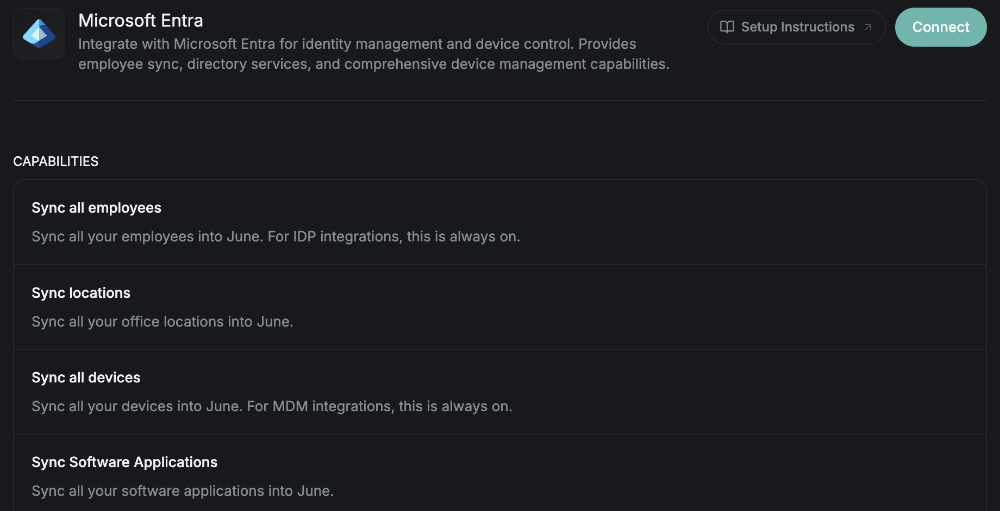

<Frame>
  
</Frame>

Connect Microsoft Entra ID with June to sync your employees and directory, and to manage enrolled devices, all from one place. You can also choose to show your Azure virtual machines.

## What you'll accomplish
- Connect Microsoft Entra with a single admin-consent sign-in
- Sync employees, locations, and software applications
- Manage enrolled devices and run device actions
- Optionally, show your Azure virtual machines and what they cost

## Capabilities

### Data synchronization

| Capability | Description |
|------------|-------------|
| **Sync employees** | Email, name, department, job title, manager, and status. Always on for identity providers. |
| **Sync locations** | Your office locations. |
| **Sync software applications** | Applications managed through Microsoft Entra. |
| **Sync devices** | Inventory and specifications for devices enrolled through Microsoft. |
| **Include Azure virtual machines** | Optional, off by default. Your Azure virtual machines as devices, with their state, activity, and daily cost. See [Include Azure virtual machines](#include-azure-virtual-machines). |

### Device actions

| Action | Description |
|--------|-------------|
| **Restart device** | Remotely restart a managed device. |
| **Shut down device** | Remotely shut down a managed device. |
| **Check in device** | Ask a device to check in and update its inventory. |
| **Delete device** | Remove a device from Intune. |
| **Assign / unassign user** | Set or clear a device's primary user. |

Intune has no locations, so assigning a device to a location in June clears its primary user in Intune.

## Prerequisites

Before starting, ensure you have:
- A Microsoft Entra tenant
- A **Global Administrator** role, to grant consent for the permissions listed in [Permissions](#permissions) below
- The Admin or Owner role in June

## Permissions

June requests the following Microsoft Graph permissions when you connect. A Global Administrator grants them once, through admin consent, and they apply across your tenant.

June changes something in your tenant only for the device actions listed below. Every other permission is read-only.

### Directory

| Permission | What June uses it for |
|------------|------------------------|
| **User.Read.All** | Reads your people directory: names, job titles, departments, office locations, employment status, hire dates, and managers. |
| **User-LifeCycleInfo.Read.All** | Reads each person's leave date, so June knows when someone is leaving. Microsoft protects leave dates with a permission separate from the rest of the directory. |
| **Directory.Read.All** | Reads groups and group memberships in your directory. |
| **RoleManagement.Read.Directory** | Reads who holds administrator roles in Microsoft Entra, including people eligible to activate a role through Privileged Identity Management, for reviewing administrator access. |

### Apps and sign-ins

| Permission | What June uses it for |
|------------|------------------------|
| **AuditLog.Read.All** | Reads sign-in activity, so June can show which apps people use and when they last signed in. Last sign-in requires a Microsoft Entra ID P1 or P2 license. |
| **Application.Read.All** | Reads the enterprise applications connected to your directory and who is assigned to them. |

### Devices

Requires a Microsoft Intune license.

| Permission | What June uses it for |
|------------|------------------------|
| **DeviceManagementManagedDevices.Read.All** | Reads your managed devices and the software installed on them. |
| **DeviceManagementApps.Read.All** | Reads the Intune audit log, so June can show each device's history. |
| **DeviceManagementConfiguration.Read.All** | Reads Intune configuration and compliance policies. |
| **DeviceManagementRBAC.Read.All** | Reads Intune administrator roles and who holds them, for reviewing administrator access. |
| **DeviceManagementManagedDevices.PrivilegedOperations.All** | Restarts, shuts down, force-checks-in, or deletes a device when an admin asks June to. Microsoft grants these actions as one permission; they can't be approved separately. |
| **DeviceManagementManagedDevices.ReadWrite.All** | Sets or clears a device's primary user when you reassign it in June. |

### BitLocker

| Permission | What June uses it for |
|------------|------------------------|
| **BitlockerKey.Read.All** | Confirms each Windows device's BitLocker recovery key is backed up, and lets an authorized June admin reveal a recovery key when they need to unlock a device. June does not store recovery keys. |

### Sign-in

| Permission | What June uses it for |
|------------|------------------------|
| **User.Read** | Lets the administrator sign in to approve the connection. |

### Azure virtual machines (optional)

Only needed if you turn on [Include Azure virtual machines](#include-azure-virtual-machines). These are Azure roles that you assign on each subscription that holds virtual machines, not Microsoft Graph permissions, so they are not part of admin consent and don't require a reconnect.

| Role | What June uses it for |
|------|------------------------|
| **Reader** | Reads virtual machines, disks, network cards, public IP addresses, and the Azure activity log. |
| **Cost Management Reader** | Reads each virtual machine's daily cost. |

<Note>
**When June asks for new permissions**

When June adds a capability that needs a new Microsoft permission, June adds it to the app registration. Your existing approval covers only the permissions you already granted, so a Global Administrator approves again: go to **Settings** > **Integrations**, select **Microsoft Entra** under **Configured Integrations**, open the **Connected** menu, and choose **Reconnect**. Until then, that capability doesn't work for your organization, and everything else keeps working.
</Note>

## Connect Microsoft Entra

<Steps>
  <Step title="Open June Integrations">
    1. Log into June.
    2. Go to **Settings** > **Integrations**.
    3. Select **Microsoft Entra** under **Available Integrations**.
  </Step>
  <Step title="Authorize with Microsoft">
    1. Click **Connect** to start the sign-in.
    2. Sign in with your Microsoft Entra **Global Administrator** account.
    3. Grant consent for the permissions listed in [Permissions](#permissions) above.
    4. On success, you return to June with the integration active.
  </Step>
  <Step title="Wait for the first sync">
    June syncs your directory and devices, then refreshes daily. To sync sooner, open the **Connected** menu on the integration's page and select **Sync Now**.
  </Step>
</Steps>

## Include Azure virtual machines

Show your Azure virtual machines in June, next to the rest of your devices. This is optional and off by default.

### What June shows

- Each Azure virtual machine appears as a device of type virtual machine.
- Whether it is running or stopped, its disks, network cards, and public IP addresses, and when it was created in Azure.
- Azure activity: who started, stopped, resized, or deleted the virtual machine, and when. Azure keeps about 90 days of this.
- Running cost: the virtual machine's daily cost from Azure, including reservations and savings plans, and the hours Azure billed for compute each day. A stopped (deallocated) virtual machine bills no compute hours.
- A virtual machine that Intune also manages shows as one device, not two.
- An Azure Virtual Desktop session host shows as a virtual machine device. June does not show host pools, assigned users, or sessions.

This is read-only. June never starts, stops, or changes a virtual machine.

### Turn it on

<Steps>
  <Step title="Give June access in Azure">
    Do this on each subscription that holds virtual machines. You need the **Owner** or **User Access Administrator** role in Azure to assign roles.

    1. In the Azure portal, open the subscription and go to **Access control (IAM)** > **Add role assignment**.
    2. Choose **Reader**, then select the June app as the member. In Azure it appears as **June Ops Integration**.
    3. Repeat for **Cost Management Reader**.
  </Step>
  <Step title="Turn it on in June">
    1. Go to **Settings** > **Integrations** and select **Microsoft Entra**.
    2. Turn on **Include Azure virtual machines**.
  </Step>
  <Step title="Wait for the next sync">
    Virtual machines appear after the next sync, which runs daily. To sync sooner, open the **Connected** menu and select **Sync Now**.
  </Step>
</Steps>

No new Microsoft Graph permission and no reconnect is needed.

### Check that it works

Open the **Connected** menu on the integration's page and select **Test Connection** to see each Azure subscription and what June can read on it: virtual machines and cost readable, or which role is missing (**Reader**, **Cost Management Reader**, or both). If no subscriptions are listed, the **June Ops Integration** app has no role on any subscription yet.

With only **Reader**, virtual machines show without cost.

### Limits

- Subscriptions billed through a reseller (classic CSP) are not supported.
- June reads only subscriptions where the app holds a role.
- A problem reading Azure never stops the rest of the Microsoft Entra sync.
